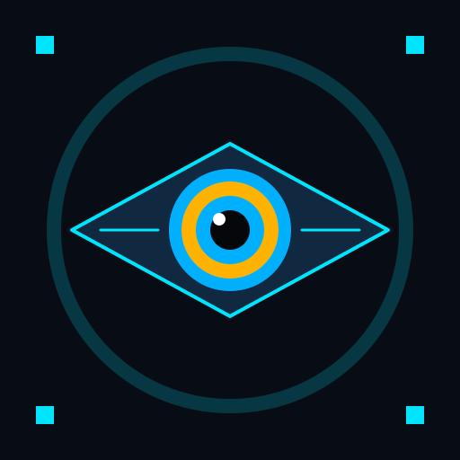
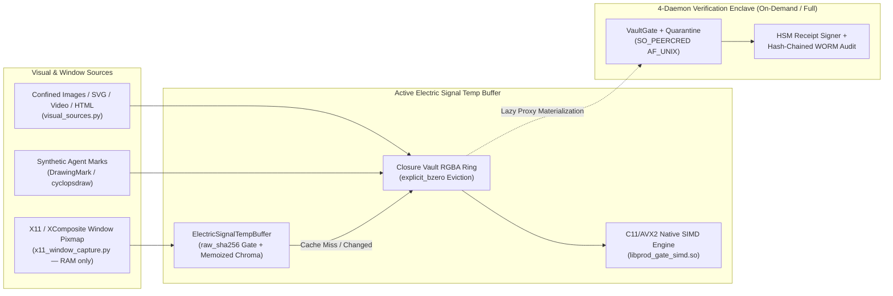

# Electric Vision (`electric-vision`)

**Deterministic, Zero-Leakage Pixel & Continuous Window Perception Enclave for Autonomous AI Agents**



[](LICENSE)
[](pyproject.toml)
[](prod_gate_native_simd.c)

**Electric Vision** gives AI agents deterministic, provenance-pinned visual perception (`128x128` through `1920x1080`) built as a verifiable physical measurement enclave rather than a black-box guesser.

It measures **exact physical quantities** (luminance, contrast, colour swatches, spatial bounding boxes, connected components, Sobel edge density, 64-bit `dhash64` perceptual hashes, $16\times16$ dirty-tile bitmasks, pairwise diffs, and multi-frame settling/oscillation regimes), enforces strict **epistemic boundaries** (never hallucinating semantics, OCR, or user intent), and guarantees **memory-only zeroization (`explicit_bzero`)** of raw pixel buffers.

---

## Key Capabilities

### 1. Active Electric Signal Temp Buffer (`signal_buffer.py` + `ingest_signal_frame`)
Instead of re-decoding, re-quantizing, and live-translating every frame into synthetic `DrawingMark` proxy primitives on every sweep:
* **`ElectricSignalTempBuffer`** holds bounded active derived signals per window/source (`raw_sha256`, `pixel_sha256`, `dhash64`, $3\times3$ coarse region light/colour, and memoized $48\times36$ chromatic swatches) in volatile RAM while keeping raw $512\times512$ RGBA frames isolated inside `_multi_res_vault` with automatic `explicit_bzero` eviction.
* **O(1) Signal Buffer Hit (`ingest_buffered_repeat`)**: When a source's raw capture SHA-256 matches its active buffered signal, Pillow decoding, cropping, resizing, chromatic scans, and live proxy translation are skipped completely — advancing temporal window settling (`initializing -> still -> settled`) in **~0.02 ms** with 100% bit-exact parity.
* **Fast AVX2 Signal Update (`run_fast_signal_operators_native`)**: When a window changes, native C11/AVX2 operators compute `dhash64`, `op_sobel_edge_density_q16`, `op_mean_rgba_u8`, `op_bbox_aligned_diff_u8`, and $16\times16$ dirty-tile masks in **~0.3 ms**.
* **Lazy Enclave & On-Demand Proxy Materialization (`lazy_enclave=True`)**: Continuous sight streams run inside a single lightweight process and lazily boot the 4 out-of-process enclave daemons / materialize $128\times128$ proxy marks only when an explicit agent query (`inspect_canvas`, `compare_canvases`, `preview_ghost_marks`, `evaluate_agent_query`) requests them.

### 2. In-Process X11 / XComposite Zero-Disk Window Capture (`x11_window_capture.py`)
* **`X11WindowCapture`** enumerates X11 windows via `_NET_CLIENT_LIST` and grabs composited window backing pixmaps directly in memory via `libX11` + `libXcomposite` (`XCompositeNameWindowPixmap` + `XGetImage`), with automatic fallback to `wmctrl` / `import`.
* Eliminates external screenshot subprocesses and full-resolution zlib PNG encode/decode overhead (~11× faster per window).
* Computes pre-decode SHA-256 against the active signal buffer and unconditionally wipes raw X11 capture buffers via `explicit_bzero` before returning.

### 3. 10 Closed-Form Integer / `Q16.16` Native SIMD Operators (`prod_gate_native_simd.c` & `.rs`)
* Zero IEEE-754 floating-point non-determinism in enclave operators; verified across **10,000 seeded differential fuzz cases** with **100% bit-exact replay parity** (`deterministic_replay_equality == 1.0`).
* Startup self-test with automatic reference-engine rollback and SHA-256 shared-library pinning (`TRUSTED_SIMD_LIBRARY_SHA256`).
* Operators:
  1. `op_mean_rgba_u8` (`Q16.16` channel sums & means)
  2. `op_min_max_luma_u8` (BT.601 integer luma bounds)
  3. `measure_bbox` (foreground & colour-tolerance bounding boxes)
  4. `op_exact_color_match_count`
  5. `op_bbox_aligned_diff_u8` (AVX2 pixel diff + diff bounding box)
  6. `op_sobel_edge_density_q16`
  7. `op_contrast_ratio_wcag_q16` (IEC sRGB integer WCAG contrast)
  8. `op_histogram_luma_16bin`
  9. `op_perceptual_hash_dhash64`
  10. `op_alpha_coverage_q16` & 4-connected foreground component extraction

### 4. Out-of-Process 4-Daemon Security Enclave & Epistemic Hygiene
* **`OutOfProcessHsmKmsEnclaveDaemon`**, **`OutOfProcessVaultGateDaemon`**, **`OutOfProcessAuditSinkDaemon`**, and **`OutOfProcessQuarantineAndKillSwitchDaemon`** over `SO_PEERCRED`-verified Unix domain sockets (`prctl` `PR_SET_DUMPABLE=0`, `PR_SET_NO_NEW_PRIVS=1`).
* **Automatic Stale-Observation Decay**: Any `verified` observation receipt is automatically demoted to `stale` (`ERR_STALE_OBSERVATION_SUPERSEDED`) with hash-chained WORM audit logging as soon as a subsequent stream frame mutates the canvas.
* **Non-Destructive Ghost Plane (`preview_ghost_marks` / `verify_ghost_realization`)**: Agents can stage hypothetical drawing marks on `ghost_isolation_plane` (`observed=False`, `ghost_pixel_leakage_bytes == 0`) and score convergence against realized frames.
* **Confined Visual Source Loaders & MCP Server (`visual_sources.py`, `electric_vision_mcp.py`)**: Descriptor-pinned (`O_NOFOLLOW` / `openat`-confined), byte- and pixel-bounded loaders for images, SVGs, video frames (`ffmpeg`), and offline HTML pages, exposed over a zero-leakage JSON-RPC MCP server.

---

## Architecture



---

## Quick Start

### Requirements
* Linux (`x86_64` with AVX2 for the prebuilt `libprod_gate_simd.so`; `gcc` to rebuild)
* Python `3.10+` and `Pillow` (`python-xlib` optional for in-process `_NET_CLIENT_LIST` window enumeration; `ffmpeg` optional for video inspection)

```bash
pip install Pillow python-xlib

# Verify C11/AVX2 build, run all 72+ unit & differential test suites, and run CLI self-test:
make all
```

### Continuous Window Sight with Active Signal Temp Buffering

```python
from desktop_sight import DesktopSight, SIZE
from signal_buffer import ElectricSignalTempBuffer
from x11_window_capture import X11WindowCapture

eye = DesktopSight(lightweight=True)
x11 = X11WindowCapture()
buf = ElectricSignalTempBuffer(max_entries=16)

try:
    windows = x11.list_windows()
    if windows:
        xid, wm_class, title = windows[0]
        stream = eye._session.create_continuous_stream("src_demo_win", width=SIZE[0], height=SIZE[1], max_window_frames=8)

        for tick in (1, 2, 3):
            active = buf.get("demo", xid)
            img, raw_sha, frame_size = x11.capture_window(
                xid,
                prev_raw_sha256=active.raw_sha256 if active else None,
                prev_size=active.size if active else None,
            )
            obs = buf.observe_frame(
                target_id="demo",
                xid=xid,
                title=title,
                stream=stream,
                tick=tick,
                img=img,
                raw_sha256=raw_sha,
                size=frame_size,
            )
            print(f"tick={tick} buffered={obs['buffered']} move={obs['move']} -> {obs['words']}")
finally:
    buf.clear()
    x11.close()
    eye.close()
```

### Full Enclave Canvas Inspection & Cryptographic Receipts

```python
from electric_vision_agent_bridge import ElectricVisionAgentSession

with ElectricVisionAgentSession(default_resolution=(256, 256)) as session:
    session.register_synthetic_canvas(
        "src_demo",
        "v1",
        [
            {"type": "fill", "color": "#101828"},
            {"type": "ring", "x": 128, "y": 128, "r": 56, "stroke": 8, "color": "#38bdf8"},
        ],
    )
    report = session.inspect_canvas("src_demo", "v1", issue_observation_receipt=True)
    print("Observed:", report["render"]["observed"])
    print("dHash64:", report["native_simd_metrics"]["op_perceptual_hash_dhash64"])
    print("Receipt ID:", report["observation_receipt"]["receipt_id"])
```

### MCP Server (`electric_vision_mcp.py`) & Terminal CLI (`electric_vision_cli.py`)

```bash
# Run standalone deterministic CLI self-test (supports --no-color / NO_COLOR and --plain 7-bit ASCII):
python3 electric_vision_cli.py --no-color --plain --mode focus selftest

# Start stdio MCP server confined to allowed workspace roots:
python3 electric_vision_mcp.py --root /path/to/workspace
```

---

## Repository Layout

| File | Purpose |
| :--- | :--- |
| `signal_buffer.py` | `ElectricSignalTempBuffer` — active per-source electric/visual signal cache & memoized swatch extractor |
| `x11_window_capture.py` | `X11WindowCapture` — persistent Xlib window lister & `libX11`/`libXcomposite` memory-only `explicit_bzero` capture |
| `electric_vision_agent_bridge.py` | `ElectricVisionAgentSession` & `ContinuousElectricEyeStream` (active signal ring, lazy enclave, ghost plane, receipts) |
| `desktop_sight.py` | `DesktopSight` — memory-only companion continuous desktop glance (`companion_desktop_glance`) |
| `continuous_vision.py` | `ContinuousVision` — bounded source-pinned temporal field recording & overview panels |
| `visual_sources.py` | Confined, byte/pixel-bounded loaders for images, SVG, video frames, and offline HTML pages |
| `prod_gate_native_simd.c` / `.rs` | C11/AVX2 & `#![forbid(unsafe_code)]` Rust integer/`Q16.16` closed-form SIMD operators |
| `prod_gate_enclave.py` | Out-of-process HSM/KMS enclave, SIMD wrapper, PII canary scrubber, and PROD-GATE-1..4 verification |
| `exec_gate_daemons.py` | Out-of-process `VaultGate`, `AuditSink` (hash-chained WORM), and `QuarantineAndKillSwitch` daemons |
| `electric_eye_harness.py` | Core `ElectricEyeFixtureHarness` closed-form 128×128 proxy engine & epistemic boundary firewall |
| `electric_vision_mcp.py` | Zero-leakage stdio Model Context Protocol (MCP) server for agent tool integration |
| `electric_vision_cli.py` | Terminal CLI inspector & self-test runner (`NO_COLOR` & `--plain` ready) |

---

## License

Released under the [MIT License](LICENSE).
